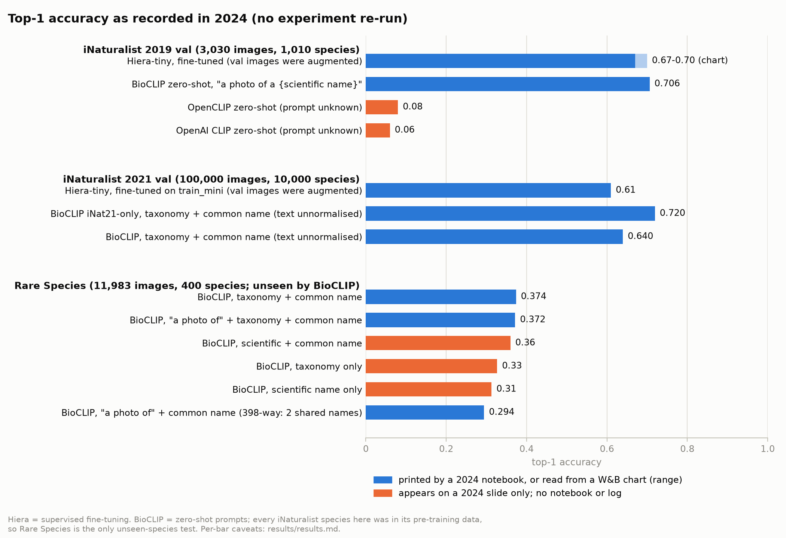

# Species Classification with Hiera and BioCLIP

This repository collects the work I did as a research intern at the Vector Institute in the
summer of 2024, under the supervision of Graham Taylor. We wanted to know how far two quite
different approaches could get at recognising species from photographs. The first was to
fine-tune a Hiera vision transformer on the iNaturalist competition datasets. The second was to
take BioCLIP, a CLIP model pre-trained on biological images, and ask it to classify species
zero-shot from nothing more than the species name written into a text prompt. Along the way we
also looked at how the wording of that prompt, whether a common name, a scientific name, the
full taxonomy, or some combination, changes what BioCLIP gets right.

In 2026 we went back over everything. We rewrote the training and evaluation code so that it
runs on any machine and is covered by tests, we checked every claim from the original write-up
and slides against the notebooks and logs that survived, and we wrote down what held up and
what did not. We did not re-run the experiments, so every number in this README is the value we
recorded in 2024, with its caveat beside it. The original scripts, notebooks and presentation
are kept under [`archive/2024-original/`](archive/2024-original/) and at the git tag
`original-2024`.



## What we did

### Fine-tuning Hiera on iNaturalist

We started from `hiera_tiny_224`, initialised with the self-supervised MAE checkpoint trained on
ImageNet-1k, and fine-tuned the whole network on two datasets: iNaturalist 2019, with 265,213
training images over 1,010 species, and the "mini" training split of iNaturalist 2021, with
500,000 images over 10,000 species. We used the standard MAE fine-tuning recipe, which the Hiera paper
also uses: AdamW with weight decay 0.05, layer-wise learning-rate decay of 0.65, label smoothing of
0.1, RandAugment, MixUp and CutMix, and a batch size of 512, on a single A40 at roughly thirty
minutes per epoch. We measured top-1 accuracy on the official validation splits after each epoch
and logged everything to Weights & Biases.

One thing we want to be clear about, because our original write-up got it wrong: Hiera's
"hierarchy" refers to its spatial pyramid of feature maps, which shrink in resolution and grow in
channels through four stages. It has nothing to do with biological taxonomy. Our classifier was
a flat softmax over species and never saw the taxonomic tree.

### Zero-shot classification with BioCLIP

We evaluated BioCLIP, a ViT-B/16 CLIP model pre-trained on the TreeOfLife-10M dataset, without
any fine-tuning. For every species we wrote one text prompt, embedded the prompt and the image
with BioCLIP's two encoders, and took the species whose prompt had the highest cosine similarity
to the image. We ran this on the iNaturalist 2019 and 2021 validation splits, where we also
compared BioCLIP against the ablation checkpoint that the BioCLIP authors trained on
iNaturalist 2021 alone, and on the Rare Species dataset: 11,983 Encyclopedia of Life images of
400 species on the IUCN Red List, which the BioCLIP authors deliberately held out of their
training data. On Rare Species we compared the prompt formats from the BioCLIP paper, namely the
common name, the scientific name, the full seven-rank taxonomy, and the combinations of these,
each with and without a leading "a photo of".

## Results

| Experiment | Top-1 accuracy | Where the number comes from |
|---|---|---|
| Hiera-tiny fine-tuned on iNaturalist 2019, evaluated on its 3,030 validation images | 0.67 to 0.69 | W&B accuracy chart |
| Hiera-tiny fine-tuned on iNaturalist 2021 mini, evaluated on its 100,000 validation images | about 0.61 | W&B accuracy chart |
| BioCLIP on iNaturalist 2019 validation, prompt "a photo of a {scientific name}" | 0.706 | notebook output |
| BioCLIP on iNaturalist 2021 validation, prompt "{taxonomy} with common name {common name}" | 0.640 | notebook output |
| BioCLIP trained on iNaturalist 2021 only, same prompt and split | 0.720 | notebook output |
| BioCLIP on Rare Species, common names only | 0.294 | notebook output |
| BioCLIP on Rare Species, taxonomy plus common name, with and without "a photo of" | 0.372 and 0.374 | notebook outputs |

The two Hiera numbers are approximate. The trained checkpoints were never committed, and the
only record of those runs is the Weights & Biases report in `results/historical/`, whose charts
show the 2019 run at about 45 epochs and the 2021 run at about 52 of the 300 we had configured.
The 2021 run peaked near 0.61 around epoch 30 and had drifted down to about 0.56 by the time the
report was exported. Both runs also carry two defects we describe in the next section: the
validation images went through the training augmentations, and stochastic depth was never
actually applied.

The BioCLIP numbers on iNaturalist are exact, but they are not what they first appear to be.
TreeOfLife-10M contains the entire iNaturalist 2021 training split, so BioCLIP had seen every
one of those 10,000 species during pre-training, along with the very taxonomic and common-name
text we put in the prompts. The 2019 validation species almost certainly overlap too, although
no mapping between the two competitions exists, so we cannot say how much. These evaluations
are zero-shot only in the sense that we did not fine-tune anything. The two iNaturalist 2021
numbers also come from a notebook that forgot to normalise the text embeddings, so the scores
were not the cosine similarities we intended, and the second checkpoint was run with the first
checkpoint's preprocessing object. The Rare Species results are the one place where BioCLIP was
genuinely looking at species it had never seen, which is why we think they are the most
interesting numbers in the project.

The Rare Species results need one more caveat. Only 398 of the 400 species have a distinct
common name, because two pairs of species share one: *Acropora acuminata* and *A. millepora* are
both "staghorn coral", and *Tylototriton shanjing* and *T. verrucosus* are both "Yunnan Newt".
Our common-name notebook built its label list from the unique names, so it silently merged those
pairs and scored a 398-way task, whereas the taxonomy prompts scored all 400. The gap of almost
eight points between them is far larger than the merge could explain, so the ordering stands,
but the numbers are not measured on exactly the same task. The slides from 2024 show three more
prompt formats on Rare Species, and CLIP and OpenCLIP baselines on iNaturalist 2019, for which
no notebook or log survives; we show them in the figure in a separate colour and do not rely on
them. The original README also described a precision-recall metric and an embedding-similarity
metric, which we proposed but never implemented, so top-1 accuracy is the only metric we have.
The full provenance of every number, down to the notebook cell, is in
[`results/results.md`](results/results.md), and the claim-by-claim check of the 2024 write-up is
in [`docs/claims_audit.md`](docs/claims_audit.md).

## What we found when we went back over the code

Reading the 2024 scripts again two years later was instructive. The most consequential problem
was one we did not notice at the time: Hiera's classification head applies a softmax whenever
the model is in evaluation mode, and our validation loop fed those probabilities straight into
cross-entropy, so every validation loss we logged was simply the logarithm of the number of
classes and told us nothing. The accuracies were unaffected, because a softmax does not change
the argmax, which is why the training still looked healthy. We had also written a block of code
to add stochastic depth to Hiera that matched none of its modules and therefore did nothing, we
set MixUp and CutMix alpha values that were never passed to the constructors, and we applied the
training augmentations to the validation images as well. On the BioCLIP side, besides the
normalisation and preprocessing mistakes above, the notebooks assumed that a prediction index
equalled a dataset category id, depended on variables defined in other sessions, and could only
run on a GPU.

We have fixed all of this in the new code under `src/biodiv/`, which is covered by tests that
use small synthetic fixtures and real samples of the upstream record formats, so none of it
needs the datasets or the model weights to run. Each fix is described in
[`docs/changes.md`](docs/changes.md), with a note on whether it changes experimental behaviour.
We have left the 2024 numbers exactly as we measured them rather than quietly replacing them, and
a run of the corrected code should be reported as a new experiment, not as a confirmation of the
old ones. How each checkpoint relates to each evaluation set, including what we could confirm
about data overlap and what remains unknown, is in
[`docs/evaluation_validity.md`](docs/evaluation_validity.md).

## Try it

The quickest way to see the project working is the demo, which runs BioCLIP zero-shot against
the 400 Rare Species labels. With `--sample` it streams a handful of labelled images from the
dataset so you can check the predictions against the ground truth; with `--image` it classifies
your own photographs. The first run downloads the pinned checkpoint, about 600 MB, and for
`--sample` one shard of the dataset, about 250 MB.

```bash
pip install torch torchvision --index-url https://download.pytorch.org/whl/cpu   # or a CUDA build
pip install -e ".[hub]"
python scripts/demo.py --sample 6
python scripts/demo.py --image my_photo.jpg --prompt-style common --prefix "a photo of "
```

This is what the first command printed on an eight-core CPU, in 39 seconds including the model
load:

```
checkpoint imageomics/bioclip@ce901ab3c6a9 on cpu; 400 species labels; prompt style 'taxonomic_common', prefix ''

dataset row 0   true: Cyclonaias tuberculata (purple wartyback)
  1. Cyclonaias tuberculata       purple wartyback               cosine 0.262  <- correct
  2. Haliotis roei                Roe's abalone                  cosine 0.191
  3. Wallago attu                 freshwater shark               cosine 0.190
  4. Aonyx capensis               African Clawless Otter         cosine 0.176
  5. Potamilus amphichaenus       Texas heelsplitter             cosine 0.172

dataset row 200   true: Anolis koopmani (Koopmans Anole)
  1. Negaprion acutidens          sicklefin lemon shark          cosine 0.190
  2. Onychoprion aleuticus        Aleutian Tern                  cosine 0.189
  3. Thinornis cucullatus         Hooded Dotterel                cosine 0.185
  4. Rhinoderma darwinii          Darwin's Frog                  cosine 0.183
  5. Negaprion brevirostris       lemon shark                    cosine 0.183

dataset row 400   true: Ceratophora tennentii (Rhinoceros Agama)
  1. Anolis bitectus              Roof Anole                     cosine 0.283
  2. Anolis macrolepis            Big-scaled Anole               cosine 0.244
  3. Anolis baracoae              Baracoa Anole                  cosine 0.241
  4. Anolis luciae                Saint Lucian Anole             cosine 0.230
  5. Anolis barbouri              Hispaniolan Hopping Anole      cosine 0.222

dataset row 600   true: Euryceros prevostii (Helmet Vanga)
  1. Paradisaea rubra             Red Bird-of-Paradise           cosine 0.203
  2. Campylopterus villaviscensio Napo Sabrewing                 cosine 0.193
  3. Mantella aurantiaca          Golden Mantella                cosine 0.191
  4. Ognorhynchus icterotis       Yellow-eared Parrot            cosine 0.188
  5. Sericossypha albocristata    White-capped Tanager           cosine 0.184

dataset row 800   true: Adetomyrma venatrix (dracula ant)
  1. Adetomyrma venatrix          dracula ant                    cosine 0.226  <- correct
  2. Ognorhynchus icterotis       Yellow-eared Parrot            cosine 0.215
  3. Balaeniceps rex              Shoebill                       cosine 0.192
  4. Pontoporia blainvillei       Franciscana                    cosine 0.191
  5. Naultinus stellatus          Starry Tree Gecko              cosine 0.189

dataset row 1000   true: Acropora millepora (staghorn coral)
  1. Stylophora pistillata        Hood Coral                     cosine 0.284
  2. Acropora acuminata           staghorn coral                 cosine 0.270
  3. Acropora millepora           staghorn coral                 cosine 0.268  <- correct
  4. Fungia fungites              Common Mushroom Coral          cosine 0.244
  5. Acropora cervicornis         Staghorn Coral                 cosine 0.233

top-1 correct on these 6 streamed samples: 2/6 (a demo, not an evaluation)
```

Two correct out of six is in line with the 37% we recorded on the full set. The last sample
happens to show the shared-common-name problem in action: *Acropora acuminata* and
*A. millepora* are both "staghorn coral" and score within 0.002 of each other.

## Where everything is

The shared code lives in `src/biodiv/`: loading the iNaturalist annotation files with an explicit
category map, separate training and evaluation transforms, Hiera construction, the learning-rate
schedule, checkpoint saving and resuming, the training loop, the zero-shot evaluator, and
loading of pinned checkpoints. The command-line entry points are in `scripts/`: `demo.py`,
`train_hiera.py`, `eval_bioclip.py` and `make_results_figure.py`. The training recipes for both
datasets and the pinned Hugging Face revisions are in `configs/`. The three notebooks in
`notebooks/` cover the iNaturalist 2021 evaluation, the Rare Species prompt comparison, and a
tutorial on navigating the iNaturalist data; they are committed without outputs and run on the
fixtures when the real data is absent. The results table, the machine-readable inventory and the
2024 Weights & Biases report are in `results/`, and the audit documents, the reproduction guide,
the environment record, the licensing notes and the presentation (as `.pptx` and PDF) are in
`docs/`. The tests are in `tests/` and run in CI together with the notebooks.

## Reproducing the experiments

The tests and smoke runs need nothing beyond the Python packages:

```bash
pip install -e ".[dev]" && pytest -q
```

The real experiments need the iNaturalist competition data on disk and, for training, a GPU:

```bash
python scripts/train_hiera.py --config configs/hiera_inat2019.yaml
python scripts/eval_bioclip.py --dataset rare-species --checkpoint bioclip --prompt-style taxonomic_common
```

The dataset layout, the three environment variables that set the data, cache and output
locations, the full list of commands, and the status of every check we performed are in
[`docs/reproduction.md`](docs/reproduction.md).

## What we learned

Most of what went wrong in 2024 would have been caught by habits we now consider basic. A
validation loss that sits at the logarithm of the class count should have been a red flag
instead of a curiosity. A single assertion that the validation transform contains no random
operations would have caught the augmentation mistake. Saving per-image predictions, rather
than only an aggregate accuracy, would have let us revisit the 398-versus-400 question without
re-running anything, and recording package versions and checkpoint revisions would have made
the numbers reproducible rather than merely recorded. Above all, we learned to ask what a model
had already seen before calling an evaluation zero-shot.

## Acknowledgements and references

Thank you to Graham Taylor for supervising this work at the Vector Institute, to the University
of Guelph's Machine Learning Reading Group, and to the iNaturalist community, without whom none
of these datasets would exist.

Hiera is described in Ryali et al., "Hiera: A Hierarchical Vision Transformer without the
Bells-and-Whistles" (ICML 2023); its code is released under Apache-2.0 and its weights under
CC BY-NC 4.0. BioCLIP, TreeOfLife-10M and the Rare Species dataset are described in Stevens et
al., "BioCLIP: A Vision Foundation Model for the Tree of Life" (CVPR 2024); the model is MIT
licensed and the datasets are CC0. The iNaturalist 2019 and 2021 competition datasets are from
Van Horn et al. and the Visipedia team, and may be used for non-commercial research only, with
no redistribution of images. We also relied on open_clip, torchvision and Weights & Biases.

This repository is released under the MIT License; see `LICENSE` and
[`docs/licensing.md`](docs/licensing.md) for the third-party terms.
